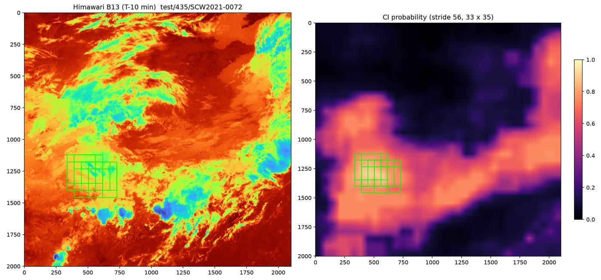

# ExtremeWeather-SSL-Ensemble

**Convection-initiation detection and object-level warning from Himawari-8 infrared sequences**

This repository is a from-scratch rebuild of an earlier CI-detection pipeline.
It keeps the original goal (detect the first appearance of a convective cell
from 4 infrared frames) but replaces the parts that did not work, and documents
every experiment — including the failed ones — in
[docs/EXPERIMENTS.md](docs/EXPERIMENTS.md).

Version history: **v0** (course prototype, audited and rejected) → **v1**
(frozen protocol, physical features, calibrated ensemble) → **v2** (keypoint
heatmap head, object-level localisation, dense full-domain perception,
operational warning tiers — the current best) → **current phase** (engineering
normalisation and repair of the confirmed defects, from 2026-11-13).

**Want to run it?** [docs/LOCAL_RUN.md](docs/LOCAL_RUN.md) lists the requirements,
what ships in the repo, and a no-Slurm local runner. Quick start with no data at all:

~~~
pip install numpy scipy matplotlib pillow
python3 tools/selfcheck.py
python3 tools/make_panel_v2.py      # rebuild the forecaster panel
~~~

---

## Headline results

### Window-level (does this ~250 km window contain a CI cell?)

Held-out test period (2021-05-14..31, 200 timestamps frozen with seed 909
before the model was ever run on it, 61,200 windows, 14,880 CI windows):

| model | split | ROC-AUC | PR-AUC | CSI | POD | FAR |
|---|---|---|---|---|---|---|
| legacy pipeline (v0), threshold tuned on the report set | benchmark | 0.6745 | 0.2474 | 19.87% | 37.6% | 70.4% |
| v1, 1 seed | test | 0.8016 | 0.5771 | 43.08% | 66.1% | 44.7% |
| v1, 5 seeds + TTA | benchmark | 0.7433 | 0.3907 | 30.1% | 44.5% | 51.8% |
| v1, 5 seeds + TTA | test | 0.8062 | 0.5742 | 42.01% | 74.11% | 50.77% |
| CINet_v2, 5 seeds (before repair) | benchmark | 0.7463 | 0.3851 | 30.35% | 43.91% | 50.43% |
| CINet_v2, 5 seeds (before repair) | test | 0.8191 | 0.5993 | 43.62% | 74.56% | 48.75% |
| **CINet_v2, repaired (E15)** | benchmark | 0.7480 | 0.3984 | 29.75% | 44.34% | 52.51% |
| **CINet_v2, repaired (E15)** | test | **0.8298** | **0.6142** | **44.90%** | **75.79%** | **47.58%** |

Sources: `experiments/final/test_metrics_seed5.json` (v1) and
`cinet_v2_ensemble_metrics.json` (v2). The 5-seed v1 model beats the single-seed
version on dev and on the benchmark; on the test it ranks better and detects
more at the cost of a slightly higher false-alarm share. Both are reported
rather than cherry-picked.

The v2 window-level gain over v1 is modest (+0.003 AUC on the benchmark, inside
the +/-0.017 noise band; +0.0129 on test, with FAR below 50% for the first time).
**The real v2 advance is object-level localisation, not window classification.**

The benchmark is the 30 official validation timestamps (9,180 windows, 12.8%
positives). The test period is more active (24.3% positives) and larger, which
is why the numbers are higher; both are reported, and neither the threshold
nor the calibration was ever fitted on the test period.

At fixed false-positive rate on the test set (v1): POFD <= 10% gives POD 49.8%
and CSI 38.0%; POFD <= 20% gives POD 69.1% and CSI 42.6%.

### Object-level (can it point at the cell? 30 km tolerance, greedy nearest-neighbour bipartite matching)

Ground truth: 463 cells on the benchmark, 6,806 on the test set.

| pipeline | split | alerts | hits | POD | CSI | FAR | mean offset |
|---|---|---|---|---|---|---|---|
| v1 + window geometric centre | test | 2,815 | 142 | 2.09% | 1.50% | 94.96% | 17.92 km |
| v1 + microphysical centroid | test | 2,815 | 185 | 2.72% | 1.96% | 93.43% | 19.31 km |
| v2 + neural/physics dual fusion | test | 2,524 | 187 | 2.75% | 2.05% | 92.59% | 19.18 km |
| v2 dual fusion, all active windows | test | 21,647 | 1,389 | 20.41% | 5.13% | 93.58% | 18.67 km |
| **dense stride-56 Hann field** | test | 57,667 | **2,868** | **42.14%** | 4.66% | 95.03% | — |
| **dense + local anvil gating** | test | 55,988 | **2,848** | **41.85%** | **4.75%** | 94.91% | 17.38 km |
| **orange tier, tau_obj = 0.65 (dev-frozen)** | test | 32,379 | **2,353** | **34.57%** | 6.39% | 92.73% | 17.56 km |
| red strict, tau >= 0.65 and dBT13 <= -2 K | test | 31,884 | 2,341 | 34.40% | **6.44%** | 92.66% | 17.56 km |

Sources: `localization_metrics.json`, `localization_physics_metrics.json`,
`cinet_v2_localization_dual_metrics.json`, `dense_perception_metrics.json`,
`operational_tiers_metrics.json`.

**All numbers above are post-repair (E15, 2026-11-16).** Operating points are
selected on dev and frozen; the pre-repair values are preserved in
`experiments/archive_v2_original/` and tabulated in EXPERIMENTS E15.

Three sentences that matter:

* Going dense broke the geometric ceiling of the coarse grid: hits **174 ->
  2,868**, POD 2.56% -> **42.14%**, mean offset ~17.4 km.
* Local 32x32 microphysical gating removed **1,679 false alerts** while keeping
  **99.30%** of true cells — an earlier coarse gating had killed 70% of them.
  Caveat (P3, still open): the gate tests neighbourhood *extrema*, so it suppresses
  only **2.9%** of candidates; the high retention reflects a weak gate rather than
  precise targeting.
* The orange tier cuts forecaster workload by **42.17%** (55,988 -> 32,379
  alerts) and raises object CSI by **34.47%** (4.75% -> 6.39%), at POD **34.57%**.
  Object-level average precision over all candidates at 30 km is **0.04276**
  (test) / 0.02088 (benchmark).

**Object-level FAR is still above 91%.** That is the main open problem, and it is
now quantified rather than guessed (EXPERIMENTS **E16**,
`experiments/final/far_diagnosis.json`, produced by the read-only
`tools/diagnose_far.py`):

* test issues **55,988 alerts against 6,806 real cells (8.23x)**. Even a *perfect*
  discriminator at that emission rate could not push FAR below **87.84%**;
* but cutting the budget alone does not work either — an oracle that emits exactly
  the true cell count still has **FAR 88.08%**, because only 11.9% of the
  top-ranked candidates are correct;
* the neural confidence separates "real CI cell" from "some other cold cloud"
  with **AUC 0.70** (window-level AUC is 0.83), and AP 0.04276 is only **1.89x**
  the shuffled-score null (0.02262);
* **54.5% of false alarms lie more than 150 km from any CI cell** — they are
  detections of other clouds, not localisation errors. Only 0.5% are within 30 km.

Conclusion: this is **primarily a supervision problem** (the label is "window
contains at least one CI cell", which a mature anvil plus one tiny cell also
satisfies), secondarily an emission-policy problem, and only marginally a
post-processing one. Stronger NMS, removing the per-timestamp score
normalisation and re-tuning the anvil gate were all measured and **none of them
moves FAR**.

---

## What the task actually is

* Input: 4 Himawari-8 IR frames (T-40 ... T-10 min), 7 bands (B08, B09, B10,
  B11, B13, B14, B16), cropped to a 224 x 224 window (0.01 deg/px, about
  250 km across). The T0 frame is never used.
* Label: `ewci/data.py` — *"a window is positive iff it contains at least one CI
  object"* at the annotation timestamp T0 (CIDS, radar >= 35 dBZ and persisting).
  **This is diagnosis, not a 30-minute forecast.** Relative to the last input
  frame there is only ~10 min of implicit lead time; true T+10/T+20/T+30
  lead-time prediction is not implemented yet.
* Why it is hard: the median CI object is 72 pixels (about 10 km, 0.14% of the
  window); about a quarter of CI objects still have warm tops; the same scene
  contains much colder mature and decaying anvils.
* Grid: 17 x 18 = 306 windows per timestamp over the full 2001 x 2101 domain.

---

## Data and splits (frozen)

Sources: /data1/group3/DATASAT/dataset/dataset.zarr (Himawari crop) and
annotations in experiments/ci_det_v2/annotations_stage1_bg (train) and
annotations_full (val/test).

| split | period (UTC) | timestamps | windows | pos rate | use |
|---|---|---|---|---|---|
| train | 2021-03-01..04-30 | 2,972 | 28,586 | 79% | fit only |
| dev | 2021-05-01..05-13, excluding benchmark | 100 | 30,600 | 14.2% | model choice, threshold, calibration |
| benchmark | 30 timestamps inside the dev period | 30 | 9,180 | 12.8% | comparison with v0 only |
| test | 2021-05-14..05-31 | 2,221 (200 used) | 679,626 (61,200 used) | 24.3% | opened once, at the end |

Frozen manifests: splits_v1.json (sha256 28ad6cf0...) and
splits_test_eval.json (sha256 24dd1972..., 200 timestamps selected with
seed 909 before the model was ever run on the test period).

Why the positive rates differ: training windows were built around CI objects;
dev/test windows are a uniform grid. This prior shift is handled with class
weights and a dev-tuned threshold, never by resampling the evaluation set.

---

## Method

**1. 51 physical features** (no learned components): brightness-temperature
statistics of B13/B08/B11/B16, cold-area fractions at 200/210/220/225/235 K,
cooling of the coldest pixel, cold-area growth, centroid displacement, six
band differences, gradient and texture statistics, and centre-crop statistics.

**2. Gradient boosting** (LightGBM, 700 trees, 3 seeds averaged) on those
features. Robust on small data, interpretable, CPU-only.

**3. Compact CNN** (41 channels: 7 bands x 4 frames + 6 band differences +
7 temporal differences; 128 px; GroupNorm + GeM pooling; about 1.2 M
parameters), trained for 6 epochs (about 20 minutes per seed on one RTX 4090)
with flips, brightness jitter and cutout, BCE with pos_weight = neg/pos.
**Five seeds** are trained and their 4-flip test-time-augmented predictions are
averaged.

**4. Ensemble** 0.9 x CNN + 0.1 GBDT, weight chosen on dev.

**5. Calibration** isotonic regression fitted on dev (never on benchmark or
test): on the test set ECE 0.252 -> 0.025 and Brier 0.208 -> 0.139.

**6. Threshold** chosen on dev only (max CSI); the benchmark and test are only
ever scored with that threshold.

> **Two dev calibrations exist — always state which one you use.**
> `test_metrics_seed5.json` carries tau_dev = **0.26050** (dev AUC 0.79155) and
> is the source of the v1 headline window metrics. The persisted `calib.json`
> carries tau = **0.27295** (dev AUC 0.79180) and is what every object-level
> localisation evaluation used. The early single-seed run used tau = 0.27966.
> Mixing them shifts CSI by about one point. Unifying them is an open task.

**7. CINet_v2** (`ewci/model_v2.py`) — **224 px** input; **Local Extremum
Attention (LEA)** between block 3 and GeM pooling (channel GAP+GMP modulation
plus multi-scale dilated spatial extremum modulation, residual gamma gate); a
lateral-fusion decoder head regressing a **28 x 28 Gaussian keypoint heatmap**
(sigma = 2 px, lambda_hm = 1.0) of cell centroids. Five seeds trained in parallel
via a Slurm array (`slurm/train_v2_parallel.slurm`, 6 epochs, batch 32,
lr 3e-4, balanced sampling). Ensemble weight 0.975 (dev sweep grid step 0.025;
earlier documents rounded it to 0.98), tau_dev = 0.31435 (re-selected on dev after the E15 repair; previously 0.95 / 0.30979).

**8. Dual coordinate refinement** —
`(y*, x*) = alpha * (y_nn, x_nn) + (1 - alpha) * (y_phys, x_phys)`, blending the
neural heatmap peak with the local cold-top / cooling centroid.

> **Protocol breach — FIXED on 2026-11-16 (E15).** The original code swept alpha
> inside the per-split loop and kept the best-CSI value *on that same split*, and
> hardcoded the tier thresholds per split (0.60 / 0.70), i.e. it tuned on the
> frozen test set. Both are now **selected on dev only and frozen** before
> benchmark/test are scored once (alpha: local_max 0.20, all_active 0.80;
> tau_obj: 0.65). `eval_operational_tiers.py` refuses to run without dev
> candidates rather than falling back to hardcoded values.
> Consequence: the old orange headline (CSI 6.46%, FAR 91.71%, −63.6% workload)
> was an **optimistic upper bound**. The honest dev-frozen point is CSI 6.39%,
> FAR 92.73%, −42.17% workload, but **POD rises from 22.63% to 34.57%**.
> The dense stage still uses a fixed alpha = 0.5; unifying that with the
> localisation alpha remains open.

**9. Dense full-domain perception** — stride **56** sliding windows, seamless
**2D Hann-window** reconstruction of a continuous probability field and keypoint
field over the whole 2001 x 2101 domain, then 2D NMS
(`--tau-prob 0.20 --tau-score 0.10`).

**10. Local microphysical anvil gating** — inside a **32 x 32** window around
each candidate, reject it as a decaying anvil when dBT13 > -0.5 K (cooling has
stopped or reversed) **and** (BT10 - BT13) < 0 K (no overshooting bubble).

**11. Three-tier operational warning** — yellow: all post-gating candidates
(maximum recall surveillance); orange: best-CSI operating threshold
(tau_obj = 0.70 on test, 0.60 on benchmark); red: tau_obj >= 0.60 and
dBT13 <= -2 K; red strict: tau_obj >= 0.70 and dBT13 <= -2 K.

---

## Audit of the legacy pipeline (why the rebuild)

The v0 code was well organised but its parts cancelled each other out:

* the 27 "ERA5" input channels were random noise (no database was mounted);
  the encoder learned the noise — feeding zeros drops its AUC from 0.72 to 0.52
  and its reconstruction R2 from +0.34 to -18.6;
* the 4 input frames were averaged by AdaptiveAvgPool3d: repeating the last
  frame 4 times gives a *better* AUC (0.738 vs 0.721) and reversing time
  changes nothing;
* global average pooling over 112 x 112 hid the 0.14%-area object;
* the autoencoder reconstructed only the mean field (R2 = 0.34 with era5,
  -0.01 without);
* "FixMatch" used the same labelled batch as its unlabelled pool;
* the threshold was tuned on the 9,180 windows that were then reported;
* the LightGBM model was not saved, so the reported number could not be
  reproduced.

Full evidence, including the wrong turns, is in docs/EXPERIMENTS.md.

---

## Negative results (kept on purpose)

* **Self-supervised pretraining did not help at this budget.** Contrastive
  pretraining on 30,000 unlabelled windows for 6 epochs (18 min) and 4 epochs of
  fine-tuning changed benchmark AUC by +0.0035 (inside the noise band), and
  lowered PR-AUC/CSI. Not used in the final model. The unlabelled pool has about
  900k windows, so this is worth revisiting with more compute.
* **ERA5 environment features gave a mixed result.** Six monthly ERA5 files
  were downloaded and seven features (CAPE, 2 m temperature, MSL, 200-850 hPa
  shear, q850, t850, t200) added at each window centre. They improve the
  benchmark (GBDT 0.707 -> 0.737 AUC; ensemble 0.733 -> 0.752) but not the
  held-out test (AUC 0.8016 -> 0.8018, CSI 43.1% -> 42.0%). Not used in the
  final model, and kept as a documented mixed result.
* **One leakage mistake**: an early 51-feature experiment reported AUC 0.825
  from a random window split; the same features give 0.709 under a proper time
  split. The corrected number is the one used everywhere.
* **TTA alone does nothing** (0.7329 -> 0.7332); the gain comes from seed
  averaging. Adding a 224 px model to the 5-seed ensemble bought only +0.0008 AUC
  at twice the training and inference cost (v1-era conclusion; v2 uses 224 px
  because the keypoint head needs the resolution).
* **Coarse anvil gating killed true cells.** In
  `cinet_v2_localization_dual_metrics.json`, gating the test local_max candidates
  dropped hits from **187 to 56** (70% of true cells lost) and made FAR *worse*
  by 0.29 points. Only the 32 x 32 local targeted gating reached 99.18%
  retention (99.30% after the E15 repair). This is the empirical reason gating
  must be local. E16 later measured that this gate fires on only 2.91% of
  candidates and is **not** a meaningful FAR lever.
* **The `pure_physics` coordinate ablation was a broken control (not a degenerate
  fusion) — fixed in E15.** In `local_physics_gating.py:73-78` the `dual` branch
  and the `else` branch (meant to be `phys`) used to be identical: both preferred
  the candidate's stored `lat/lon`, which are the alpha = 0.5 dual coordinates
  written by the dense inference. That is why `pure_physics` and `dual_optimal`
  were identical in `dense_perception_metrics.json` (test 2,427 / 17.4774 km;
  benchmark 97 / 17.7429 km). The dense fusion itself was always implemented
  correctly. After the repair the three arms differ and dual wins: test 2,790 /
  16.86 km (neural), **2,848 / 17.38 km (dual)**, 2,725 / 17.83 km (physics).
* **The 0.5/0.5 physics-centroid blend does not generalise.** On test local_max
  the pure cooling-rate centroid (`cool`) gets **201 hits** (POD 2.95%, CSI
  2.13%) versus 185 for the blend, while on the benchmark the blend wins (11 vs
  5). The weight was picked on a small split and should be re-scanned on dev.

### Full-pipeline code audit (2026-11-13)

A full read-through of the v2 pipeline found 12 defects, recorded with code
evidence in `docs/EXPERIMENTS.md` **E14**.

**Status (2026-11-16, E15): P1, P2, P6, P7, P8 and the protocol breach are fixed
and verified by measurement; P3, P4, P5, P9, P10, P11, P12 remain open.** The
table below is the original finding record, kept unchanged for provenance.
The six that mattered most:

| id | defect | evidence |
|---|---|---|
| P1 | Heatmap positive mask `target.ge(0.99)` is too strict for sigma = 2, so the positive loss term vanishes | **8,942 of 14,880 positive test windows (60.1%)** have an empty mask; `num_pos` falls back to 1. Training logs show HM loss 2.73 vs CLS 0.49 |
| P2 | Edge-truncated objects are still positives and still supply heatmap targets | **4,144 of 28,517 positive objects (14.5%)** have `complete=False`; `has_ci` only checks `label == 1` |
| P3 | Anvil gating uses 32x32 neighbourhood *extrema*, so it barely fires | only **3.24%** of candidates suppressed — the "99.18% retention" is a side effect of a very weak gate |
| P4 | Candidate score is normalised by each timestamp's own heatmap max | `tau_score` is not comparable across scenes |
| P5 | NMS radius (30 km) equals the evaluation tolerance (30 km) | two true cells 25 km apart can never both be reported — a structural recall ceiling |
| P6 | Object-level "PR-AUC 0.01674" is an 11-point truncated trapezoid area | recall only spans 13.78%–35.41%; not comparable to the window-level sklearn AP |

Also verified **correct** (no action needed): no T0 leakage, 41-channel
construction, time-based split isolation, dev-only model selection / calibration /
ensemble weight / window threshold, **TTA heatmap un-flipping**, **Hann weighted
averaging**, Haversine matching on real lat/lon (no flat-earth approximation),
bilaterally unique greedy matching, all meteorological formulas, and all five
seeds completing 6 epochs.

---

## Limitations

* Three months of data, one region (104-125 E, 20-40 N), one year (2021).
  This is a research prototype, not an operational system.
* **Diagnosis at T0, not a lead-time forecast.** See "What the task actually is".
* **Object-level FAR remains above 92%** even at the orange tier; the yellow
  surveillance list hits roughly 5 cells per 100 alerts. At that FAR the orange
  tier is **not an operational warning product** — the system is a full-domain
  surveillance and ranking aid. See E16 for the decomposition (8.23x emission
  ratio, 0.8784 structural FAR floor, object-level ranking AUC 0.70).
* On the benchmark, 3 of 8 cases are close to random (AUC 0.50-0.63); on the
  larger test set only 1 of 13 cases is weak (`SCW2021-0077`, AUC 0.6664 /
  CSI 21.93% with 5 seeds). Per-case results are reported rather than hidden.
* The test period is more active (24.3% positives) than dev (14.2%), so the
  dev-tuned threshold is conservative; POFD-constrained operating points are
  reported as well.
* The probability map is a risk field, not a per-pixel radar nowcast.

---

## Forecaster panel

**v2 (current)** — five decoupled layers: native B13 IR true-colour imagery, the
continuous CI probability field, the CINet_v2 keypoint heatmap field, 35+ dBZ
radar reflectivity truth contours, and the three-tier warning cells with
gated-out candidates marked. Self-contained single file with no CDN dependency:
Canvas pan and 0.2x-25x zoom, per-layer opacity sliders and visibility toggles,
tier filters, and a hover HUD showing lat/lon, CI probability, CINet score,
dBT13, BT13, BT10-BT13, BT11-BT13 and the 30 km radar match status.

~~~
python tools/extract_sample_dense.py --uid test/435/SCW2021-0072
python tools/make_panel_v2.py
~~~

Writes `reports/panels/panel_v2.html` (3.2 MB) and `panel_v2.png` (7.6 MB,
four-panel publication figure).

**v1** — the satellite image at T-10, a 33 x 35 probability grid, the top
hotspots with latitude/longitude/probability, and a self-contained HTML page.
It uses the five CNN seeds with TTA and the calibrated probability; epistemic
uncertainty is the standard deviation across the seeds. The panel below is the
held-out test timestamp SCW2021-0072.

~~~
python tools/make_panel.py --uid test/435/SCW2021-0072 --role test --stride 56 --device cuda
~~~

Run both on a GPU (about 2 minutes for 33 x 35 windows x 5 seeds); the same
command on CPU takes over an hour.

## Repository layout

Trained checkpoints, prediction archives, feature matrices and the dense sample
are included, so most results can be reproduced without retraining. The satellite
dataset itself is not redistributable here — see
[docs/LOCAL_RUN.md](docs/LOCAL_RUN.md).

~~~
ewci/                 data access, features, metrics, CINet v1/v2, SSL
tools/                feature builder, GBDT, CNN train/predict, localisation,
                      dense inference, gating, operational tiers, panels
slurm/                10 job scripts, all pointing at the Qoder workspace
docs/EXPERIMENTS.md   full experiment log E0-E14, including failed attempts and
                      the full-pipeline code audit
docs/LOCAL_RUN.md     requirements, local runner, known traps
tools/selfcheck.py    installation self-check (no dataset needed)
tools/local_run.sh    serial single-device runner (no Slurm needed)
tools/configure_paths.py  repoint the hardcoded data paths in one command
splits_v1.json        frozen train/dev/benchmark/test split
splits_test_eval.json frozen 200-timestamp test subset
experiments/final/    metric JSONs and prediction NPZs (authoritative numbers)
reports/panels/       forecaster panels (HTML/PNG, tracked)
reports/figures/      ROC/PR/reliability/importance figures (tracked)
pyproject.toml        packaging metadata (dependencies match the actual imports)
requirements.txt      core runtime dependencies
LICENSE               Apache-2.0
~~~

Artifacts must never land in the repository root: metrics -> `experiments/final/`,
panels -> `reports/panels/`, figures -> `reports/figures/`, documents -> `docs/`,
job logs -> `logs/`.

---

## Reproduction

These are the original cluster jobs (Slurm, four GPUs). On a laptop or a
single-GPU box run `bash tools/local_run.sh` instead — it executes the same
commands serially on one device. See [docs/LOCAL_RUN.md](docs/LOCAL_RUN.md).

On the original cluster:

~~~
source /home/group3/miniconda3/etc/profile.d/conda.sh
conda activate ci_det
cd /home/group3/group3_work/HYLiang/ExtremeWeather_SSL_Ensemble_Qoder
export PYTHONPATH=.

# 1. physical features (CPU, about 3 minutes each with 8 workers)
python tools/build_features.py --split train --out experiments/p0_gbdt/features_train.npz
python tools/build_features.py --split dev   --out experiments/p0_gbdt/features_dev.npz
python tools/build_features.py --split val   --out experiments/p0_gbdt/features_val.npz

# 2. GBDT baseline under the frozen protocol (CPU)
python tools/eval_frozen.py

# 3. v1: five CNN seeds, TTA predictions, calibration (dev only), final test
sbatch slurm/seeds_tta.slurm
python tools/fit_calibration.py
python tools/final_test5.py

# 4. v2: five seeds in parallel, TTA inference, window-level ensemble
sbatch slurm/train_v2_parallel.slurm
bash tools/predict_all_seeds_v2.sh
python tools/eval_v2_ensemble.py

# 5. v2: object localisation, dense perception, gating, operational tiers
python tools/eval_localization_dual.py
python tools/dense_inference_v2.py --split both --gpus 1,2,3,4 --stride 56
python tools/local_physics_gating.py
python tools/eval_operational_tiers.py

# 6. forecaster panel v2 (GPU, about 2 minutes)
python tools/extract_sample_dense.py --uid test/435/SCW2021-0072
python tools/make_panel_v2.py
~~~

All Slurm scripts (`slurm/seeds_tta.slurm`, `test5.slurm`, `panel.slurm`,
`train_v2_parallel.slurm`, ...) point at the Qoder workspace. Check `df -h /`
and `squeue -u group3` before submitting; the cluster has no tmux/screen, so
long runs must go through Slurm or `nohup`.

---

## What we would do next

1. **True lead-time CI nowcasting** — relabel from T0 to T+10/T+20/T+30 and
   retrain the compact model. This is the only path from diagnosis to
   forecasting, and it has been the top unbuilt item since v1
   (estimated 2-3 days of development plus single-GPU training).
2. **Attack object-level FAR** (92.73% at the dev-frozen orange tier). E16 ranked
   the remedies by measured value: (a) **pixel-level CI supervision** — the
   annotations already carry `contour_xy` / `contour_lonlat` per object, so a CI
   mask head can be trained instead of only a centre heatmap; (b) a **sharper
   keypoint head** (56x56 or 112x112, smaller sigma, larger lambda_hm — the
   recovered Hmax median is only 0.253 today); (c) **full-domain hard negatives**
   (cold cloud, no CI). Cheap and retrain-free: a dev-fitted object-level ranker
   over the six stored confidence/physics fields, core-based (not 32x32-extremum)
   microphysics, a per-timestamp top-N emission budget (N=100 measured CSI 0.0729
   vs 0.0639 for the current orange tier at 38% fewer alerts), and calibrating the
   dense path. **Stronger NMS is not on this list — it was measured and does not
   help.**
3. **Finish the remaining audited defects.** Done in E15: dev-only selection of
   alpha and tau_obj, the `phys` ablation branch, full-candidate AP, the heatmap
   anchor and truncated-object centres, the threshold search range. Still open:
   P3 core-based gating statistics, P4 per-timestamp score normalisation, P5
   decoupling the NMS radius from the evaluation tolerance, P9 model selection on
   all 100 dev timestamps, P10/P11/P12; plus unifying the two dev calibrations
   (tau 0.2605 vs 0.2729) and the dense stage's fixed alpha = 0.5, and re-scanning
   the physics-centroid blend weight on dev.
4. **Revisit SSL** with the full ~900k unlabelled pool and a much larger budget
   (spatiotemporal MAE or contrastive), on a free GPU allocation.
5. **Spatiotemporal cross-attention** for the 0.14%-area targets, replacing pure
   global aggregation.
6. **ERA5 environment gating** as a controlled ablation rather than feature
   concatenation (the six monthly files are on disk now).
7. Investigate the weak test case (`SCW2021-0077`) and the three weak benchmark
   cases: absent from training, or in need of different features?
